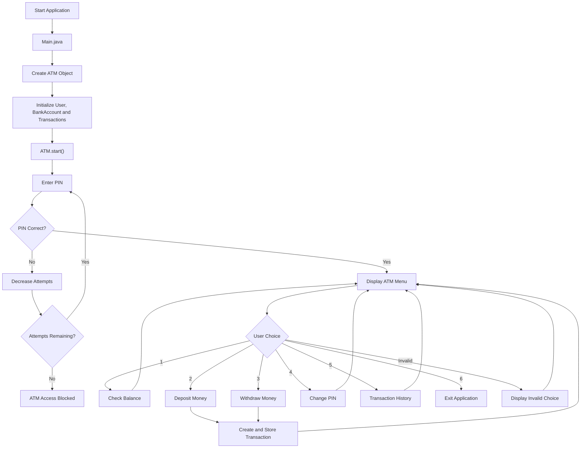

# ATM Management System – Core Java & OOP

## 1. Project Overview

The ATM Management System is a console-based Java application developed to practise Core Java fundamentals and Object-Oriented Programming (OOP) concepts.

This repository contains two implementations of the same ATM application:

- **Version 1 – Basic Java:** Implements basic ATM operations using fundamental Java programming concepts.
- **Version 2 – OOP:** Implements ATM operations using a modular, class-based approach and object-oriented programming principles.

The purpose of this project is to demonstrate the progression from basic Java programming to designing a more structured application using OOP.

## 2. Technologies Used

- Java (JDK 17)
- Object-Oriented Programming (OOP)
- Java Collections Framework (`ArrayList`)
- Scanner class for user input
- IntelliJ IDEA

## 3. Project Structure

```text
ATM-Management-System/
│
├── ATM-SYSTEM BASIC JAVA/
│   ├── src/
│   │   └── Main.java
│   └── .gitignore
│
├── ATM-SYSTEM WITH OOPS/
│   ├── src/
│   │   └── atm/
│   │       ├── Main.java
│   │       ├── ATM.java
│   │       ├── BankAccount.java
│   │       ├── User.java
│   │       └── Transaction.java
│   └── .gitignore
│
└── README.md
```

## 4. Version 1 – ATM System Using Basic Java

### Overview

The first implementation focuses on understanding basic Java programming concepts and implementing ATM operations in a straightforward manner.

### Concepts Practised

- Variables and data types
- Scanner class for taking user input
- Conditional statements (`if-else`)
- Loops
- Methods
- Arithmetic operations
- Basic input validation

### Features

- Check account balance
- Deposit money
- Withdraw money
- Display operation results

### Working

1. The application starts execution from the `main()` method.
2. The initial account balance is maintained using a variable.
3. The user selects an ATM operation.
4. Based on the selected operation, the corresponding logic is executed.
5. For deposits, the entered amount is added to the current balance.
6. For withdrawals, the entered amount is deducted from the balance after validation.
7. The updated balance is displayed to the user.

This implementation helped me understand how Java statements, variables, conditions, loops, and methods work together to build a simple console application.

## 5. Version 2 – ATM System Using OOP

### Overview

The second implementation improves the application structure by dividing responsibilities among different classes.

Each class manages specific data and functionality. This makes the application easier to understand, maintain, and extend.

### Features

- PIN-based authentication
- Maximum three login attempts
- Check account balance
- Deposit money
- Withdraw money
- Change PIN
- Transaction history
- Exit application

### Class Responsibilities

The project consists of five classes:

| Class | Responsibility |
|---|---|
| Main.java | Entry point of the application. Creates the ATM object and starts the application. |
| ATM.java | Controls application workflow, displays the menu, accepts user input, and coordinates operations. |
| BankAccount.java | Manages account balance and performs deposit, withdrawal, and balance inquiry operations. |
| User.java | Stores user details and handles PIN verification and PIN changing. |
| Transaction.java | Represents an individual transaction and stores its type, amount, and balance after the transaction. |

## 6. Complete Working of the OOP Implementation

### Step 1: Application Initialization

Execution starts from the `main()` method in `Main.java`.

```java
public static void main(String[] args) {
    ATM atm = new ATM();
    atm.start();
}
```

- The application creates an object of the `ATM` class.
- During ATM object initialization, the required objects and variables are initialized.
- A `Scanner` object is created to accept user input.
- A `BankAccount` object is initialized with an initial balance of ₹10,000.
- A `User` object is initialized with the username `vikas` and PIN `1234`.
- An `ArrayList<Transaction>` is created to store transaction records.
- The `start()` method is called to begin ATM operations.

### Step 2: PIN Authentication

Before accessing the ATM menu, the user must authenticate using their PIN.

- The application allows a maximum of three login attempts.
- The user enters their PIN through the Scanner object in the ATM class.
- ATM calls the `verifyPin()` method of the User class.
- The User class compares the entered PIN with the stored PIN.
- If both PINs match, the method returns `true` and login is successful.
- If the PIN is incorrect, the remaining attempts are decreased.
- If all three attempts fail, ATM access is blocked for the current application session.

**Method interaction:**

```text
ATM.start()
    |
    v
ATM.verifyPin()
    |
    v
User.verifyPin(enteredPin)
    |
    v
Compare entered PIN with stored PIN
    |
    v
Return true or false
```

After successful authentication, the application displays a welcome message using the user's name.

### Step 3: Display ATM Menu

After successful authentication, the ATM menu is displayed using the `showMenu()` method.

The menu provides the following operations:

```text
================================
             ATM MENU
================================

1. Check Balance
2. Deposit
3. Withdraw
4. Change PIN
5. Transaction History
6. Exit
```

The user selects an option, and the `switch` statement executes the corresponding method.

A `do-while` loop ensures that the menu continues to appear until the user selects the Exit option.

### Step 4: Check Account Balance

When the user selects option 1:

- ATM calls the `checkBalance()` method of the BankAccount class.
- BankAccount returns the current balance.
- ATM displays the available balance.

**Method interaction:**

```text
ATM.checkBalance()
    |
    v
BankAccount.checkBalance()
    |
    v
Return current balance
    |
    v
Display available balance
```

Example output:

```text
Available Balance: 10000.0
```

### Step 5: Deposit Money

When the user selects option 2:

1. ATM asks the user to enter the deposit amount.
2. ATM passes the entered amount to `BankAccount.deposit()`.
3. BankAccount checks whether the amount is greater than zero.
4. If valid, the amount is added to the existing balance.
5. BankAccount returns `true` for a successful deposit or `false` for an invalid amount.
6. If the deposit is successful, ATM creates a new Transaction object.
7. The Transaction object stores the transaction type, deposited amount, and updated balance.
8. The transaction object is added to the `ArrayList<Transaction>`.
9. ATM displays the deposit confirmation and updated balance.

**Method interaction:**

```text
ATM.deposit()
    |
    v
BankAccount.deposit(amount)
    |
    v
Validate deposit amount
    |
    v
Update account balance
    |
    v
Return operation status
    |
    v
Create Transaction object
    |
    v
Add transaction to ArrayList
    |
    v
Display confirmation
```

Example:

```text
Initial Balance: ₹10,000
Deposit Amount:  ₹2,000

Updated Balance: ₹12,000
```

### Step 6: Withdraw Money

When the user selects option 3:

1. ATM asks the user to enter the withdrawal amount.
2. ATM passes the amount to `BankAccount.withdraw()`.
3. BankAccount validates two conditions:
   - The withdrawal amount must be greater than zero.
   - The withdrawal amount must not exceed the available balance.
4. If both conditions are satisfied, the amount is deducted from the balance.
5. BankAccount returns the operation status.
6. If successful, ATM creates a Transaction object.
7. The transaction object stores the withdrawal type, amount, and remaining balance.
8. The transaction object is added to the transaction ArrayList.
9. ATM displays the withdrawal confirmation and updated balance.

**Method interaction:**

```text
ATM.withdraw()
    |
    v
BankAccount.withdraw(amount)
    |
    v
Validate withdrawal amount
    |
    v
Check available balance
    |
    v
Deduct withdrawal amount
    |
    v
Return operation status
    |
    v
Create Transaction object
    |
    v
Add transaction to ArrayList
    |
    v
Display confirmation
```

Example:

```text
Initial Balance:   ₹12,000
Withdrawal Amount: ₹500

Updated Balance:   ₹11,500
```

### Step 7: Change PIN

When the user selects option 4:

1. ATM asks the user to enter their current PIN.
2. ATM asks for a new four-digit PIN.
3. ATM asks the user to confirm the new PIN.
4. ATM checks whether the new PIN and confirmation PIN match.
5. If they do not match, the operation is cancelled.
6. If they match, ATM calls `User.changePin(currentPin, newPin)`.
7. User verifies whether the entered current PIN matches the stored PIN.
8. User validates whether the new PIN is between 1000 and 9999.
9. If both validations pass, the stored PIN is updated.
10. User returns `true`, and ATM displays a success message.

If any validation fails, the PIN remains unchanged.

**Method interaction:**

```text
ATM.changeUserPin()
    |
    v
Accept current PIN
    |
    v
Accept new PIN and confirmation
    |
    v
Compare new PIN and confirmation
    |
    v
User.changePin(currentPin, newPin)
    |
    v
Validate current PIN
    |
    v
Validate new PIN
    |
    v
Update stored PIN
    |
    v
Return operation status
    |
    v
Display result
```

### Step 8: Transaction History

When the user selects option 5:

- ATM checks whether the transaction ArrayList is empty using `isEmpty()`.
- If there are no transactions, it displays a message indicating that no transactions were found.
- Otherwise, ATM iterates through the ArrayList using a `for` loop.
- Each Transaction object is retrieved using the `get()` method.
- Getter methods retrieve the transaction type, amount, and balance after the transaction.
- The transaction details are displayed with their corresponding transaction numbers.

**Transaction class attributes:**

```java
private final String type;
private final double amount;
private final double balanceAfter;
```

The `final` keyword prevents these transaction fields from being reassigned after initialization.

Example output:

```text
Transaction History:

Transaction No: 1
Type: Deposit
Amount: 2000.0
Balance After Transaction: 12000.0

-----------------------------------------

Transaction No: 2
Type: Withdraw
Amount: 500.0
Balance After Transaction: 11500.0

-----------------------------------------
```

### Step 9: Exit Application

When the user selects option 6:

- ATM displays a thank-you message.
- The `do-while` loop terminates because the selected choice is 6.
- The `start()` method finishes.
- The application terminates.

## 7. Complete Application Flow Diagram – OOP Version



## 8. Comparison: Basic Java vs OOP Implementation

| Basic Java | OOP |
|---|---|
| Uses a straightforward programming approach. | Uses a modular, class-based approach. |
| Logic is implemented in a simpler structure. | Responsibilities are divided among multiple classes. |
| Uses basic Java concepts such as variables, conditions, loops, and methods. | Uses classes, objects, encapsulation, and object collaboration. |
| Suitable for understanding programming fundamentals. | Better structured for extending and maintaining functionality. |

The second implementation builds on the fundamentals practised in the first implementation.

## 9. Object-Oriented Programming Concepts Implemented

### 1. Encapsulation

Encapsulation is implemented by declaring data members as `private` and providing public methods to access or modify the data in a controlled manner.

Examples:

- `BankAccount`: Private balance with public methods for balance inquiry, deposits, and withdrawals.
- `User`: Private name and PIN with public methods for retrieving the name, verifying the PIN, and changing the PIN.
- `Transaction`: Private final fields with public getter methods.

### 2. Abstraction

The ATM class interacts with other classes through their public methods without needing to know their internal implementation.

For example:

```java
account.deposit(depositAmount);
```

ATM does not need to know how BankAccount validates and updates the balance internally.

### 3. Composition and Object Collaboration

The ATM class contains references to objects of other classes, such as:

- BankAccount
- User
- ArrayList of Transaction objects

These objects work together to perform ATM operations.

### 4. Constructors

Constructors are used to initialize objects with their required initial values.

Examples:

```java
new BankAccount(10000);
new User("vikas", 1234);
new Transaction("Deposit", 2000, 12000);
```

### 5. Collections Framework

`ArrayList<Transaction>` is used to store transaction objects dynamically.

Methods used:

- `add()` – Adds a transaction.
- `get()` – Retrieves a transaction.
- `isEmpty()` – Checks whether the transaction list is empty.
- `size()` – Returns the number of transactions.

### 6. Conditional Statements and Loops

- `if-else` – Validates PINs, amounts, and operation status.
- `switch` – Handles ATM menu selections.
- `while` – Controls login attempts.
- `do-while` – Repeats the ATM menu.
- `for` – Displays transaction history.

### 7. Access Modifiers

- `private` – Restricts direct access to internal data.
- `public` – Allows other classes to use exposed methods.
- Default access – Used for the BankAccount constructor within the package.

## 10. Current Limitations

The OOP implementation is a basic console-based application. It has the following limitations:

- Account balance is stored in memory and resets when the application restarts.
- PIN changes are not permanently stored.
- Transaction history is lost after the application terminates.
- The application currently supports only one hardcoded user.
- Invalid non-numeric input is not yet handled with exception handling.
- Financial calculations currently use `double` instead of `BigDecimal`.

## 11. Future Enhancements

Potential improvements include:

- Exception handling and robust input validation.
- Multiple user and bank account support.
- File handling or MySQL database integration for persistent storage.
- JDBC connectivity.
- Secure PIN storage and authentication.
- Transaction date and time tracking.
- JUnit test cases.
- Logging and exception handling.
- Spring Boot REST API integration.

## 12. Learning Outcomes

Through these two implementations, I practised:

- Understanding Core Java programming fundamentals.
- Using variables, data types, conditions, loops, and methods.
- Designing a multi-class Java application.
- Creating and working with objects.
- Applying encapsulation and basic abstraction.
- Understanding communication between objects.
- Using constructors and access modifiers.
- Working with the Java Collections Framework.
- Managing application flow using loops and conditional statements.
- Implementing basic validation and transaction tracking.
- Understanding the difference between a basic implementation and a modular OOP-based implementation.

---

**Note:** This project is developed for learning and demonstrating Core Java and OOP concepts. It is not intended for real banking transactions or production use.